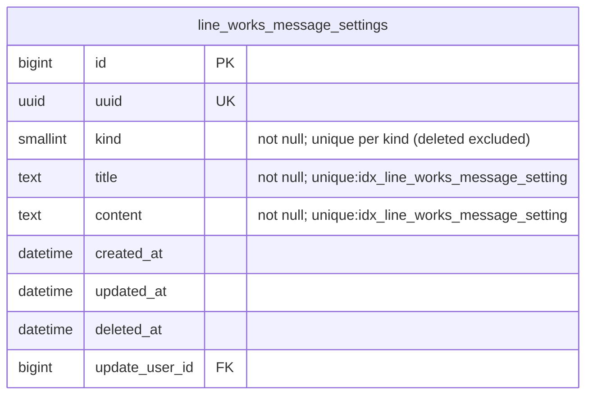

# 管理画面 — 通知タブ レイアウト（罫線）

管理画面の「通知」タブにおける、送信設定と通知文の画面構成イメージ。実装は本ドキュメントの参考用。

## 画面パス

| 階層 | 内容 |
|------|------|
| 管理＞通知 | 管理トップのタブ名は「通知」（旧: 1on1通知） |
| 管理＞通知＞送信設定 | 自動送信・タイミング・時刻 |
| 管理＞通知＞通知文 | LINE WORKS に送る文面の編集 |
| 管理＞通知＞通知文＞未提出通知 | ログ未提出向け |
| 管理＞通知＞通知文＞提出通知 | ログ提出向け |
| 管理＞通知＞通知文＞未実施通知 | 面談未実施向け |

「通知」タブ内では **送信設定** と **通知文** を同時には表示せず、サブタブで切り替える。通知文を選んだときだけ、その下に **未提出通知 / 提出通知 / 未実施通知** のサブタブを表示する。

## 共通ヘッダ（全管理タブ）

```
管理
ユーザ・組織・通知・役職名の設定を行います

[ ユーザ一覧 ] [ 組織一覧 ] [ 役職 ] [ 通知 ]
```

---

## 管理＞通知＞送信設定

```
[送信設定]  通知文

+--------------------------------------------------------------+
| 案内: 設定の保存のみ。送信そのものは別実装                   |
| [toggle] 1on1の通知を自動送信する                            |
| 通知タイミング                                               |
|   ( ) 実施予定日の N 日前                                    |
|   (o) 前の週の指定曜日                                       |
| 曜日 [ 月曜 v ]          または  何日前 [ 1 ]                |
| 送信時刻 [ 09:00 ]                                           |
|                                                              |
|                                               [保存]         |
+--------------------------------------------------------------+
```

- 保存先: `system_settings`（リマインド関連カラム）
- 保存ボタン: カード内右下

---

## 管理＞通知＞通知文＞未提出通知

（通知文サブタブを選択した状態。図は未提出通知を表示中の例。）

```
送信設定  [通知文]

            [未提出通知]  提出通知  未実施通知

+--------------------------------------------------------------+
| 挿入  (メンター) (メンティー) (年) (月) (日)                 |
| 本文                                                         |
| +----------------------------------------------------------+ |
| | [year]年[month]月のログが未提出です。                   | |
| |                                                          | |
| +----------------------------------------------------------+ |
|                                                              |
|                                               [保存]         |
+--------------------------------------------------------------+
```

### 通知文サブタブ別の本文例

| サブタブ | 本文例 |
|----------|--------|
| 未提出通知 | `[year]年[month]月のログが未提出です。` |
| 提出通知 | `[mentee]さんが[month]月のログを提出しました。` |
| 未実施通知 | `[year]年[month]月の面談が未実施です。` |

- タイトル入力欄は置かない。`line_works_message_settings.title` はサブタブ名（未提出通知 / 提出通知 / 未実施通知）に対応する。
- 編集するのは `content`（本文）のみ。
- 挿入ボタンは本文テキストエリアのカーソル位置に次の文字列を入れる。

| ボタンラベル | 挿入文字列 |
|--------------|------------|
| メンター | `[mentor]` |
| メンティー | `[mentee]` |
| 年 | `[year]` |
| 月 | `[month]` |
| 日 | `[day]` |

送信時にメンター・メンティー氏名や年月日へ置き換える。本画面ではプレースホルダ文字列のまま保存する。

- 保存先: `line_works_message_settings`（サブタブ1つ = 1行。3サブタブ分をまとめて保存）
- 保存時に `update_user_id` に操作した管理者を記録する。`uuid`・`created_at`・`updated_at`・`deleted_at` は画面に表示しない。
- 保存ボタン: 通知文枠の右下に1つ（表示中のタブのみでなく3タブ分を一括保存）

---

## 送信設定と通知文の保存

| 領域 | 保存ボタン位置 | 永続化先 |
|------|----------------|----------|
| 送信設定 | 送信設定カード右下 | `system_settings` |
| 通知文 | 通知文カード右下 | `line_works_message_settings` |

それぞれ独立したボタンとテーブルとする。

---

## レスポンシブ

狭い幅でもサブタブの並び順は同じとする。送信設定・通知文のカードは幅いっぱいに表示する。送信設定は現行どおり最大幅を抑えたカードでもよい。

---

## データモデル参考（`line_works_message_settings`）



`kind` は列挙（Draft / Submit / NotConducted）。`title` は画面タブ名と対応し固定、`content` のみ管理画面で編集する。