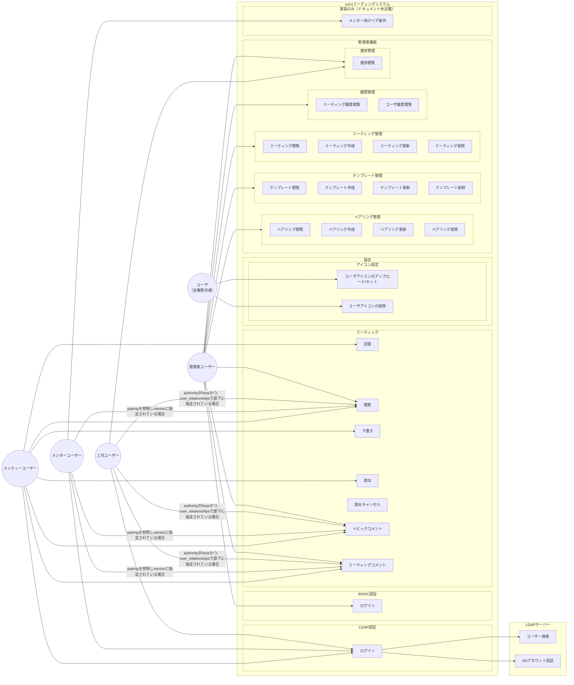

# ドキュメントと実装の差分

[usecase.md](usecase.md) / [er.md](er.md) と現状実装（`internal/`）の差分一覧。  
各項目に **正**（ドキュメント / 実装 / 要判断）を付与し、設計修正の判断材料とする。

---

## ユースケース差分

### 凡例

| 記号 | 意味 |
| --- | --- |
| 実装済 | usecase インターフェース + 実装本体が存在 |
| 部分実装 | エンティティ / リポジトリのみ、usecase 未実装 |
| 未実装 | ドキュメントのみ |
| 図の誤り | ドキュメント内の記述ミス |

### 機能別対応表

| 機能 | ドキュメント | 実装 | 正 |
| --- | --- | --- | --- |
| LDAPログイン | ldap_login | LDAPClient のみ（login usecase 無し） | ドキュメント |
| BASICログイン | basic_login | 未実装 | ドキュメント |
| 回答閲覧 | read / answer | AnswerReaderUsecase | 一致 |
| 下書き | draft | DraftSaverUsecase | 一致 |
| 提出 | submit | SubmitterUsecase | 一致 |
| 提出キャンセル | 無し | SubmitCancellerUsecase | 実装 |
| トピックコメント | answer_comment | AnswerCommenter（投稿/編集/削除） | 実装（編集・削除を追記） |
| ミーティングコメント | meeting_comment | MeetingCommenter（投稿/編集/削除） | 実装（編集・削除を追記） |
| アイコン upload/delete | upload_icon / delete_icon | IconRegister / IconRemover | 一致 |
| ペアリング CRUD | mng_pairing | pairing_management_usecase | 一致 |
| ペアリング閲覧（フィルタ） | read_pairing のみ | mentor/boss/team/department 別一覧 | 実装 |
| テンプレート CRUD | mng_template | template_management_usecase | 一致 |
| ミーティング閲覧 | 無し | MeetingViewer（mentor/boss/team/department） | 実装 |
| ミーティング作成 | create_meeting | 単発 / 全ペア / 毎月一括 | 実装 |
| ミーティング更新 | update_meeting | 実施日 / ペア / テンプレート変更 | 実装 |
| ミーティング削除 | delete_meeting | MeetingDeleter | 一致 |
| 履歴閲覧 | read_history | History エンティティのみ（repo/usecase 空） | ドキュメント |
| 進捗閲覧 | read_progress | ProgressViewer 空（interface は TODO） | ドキュメント |
| メンター向けペア操作 | 無し | pairing_usecase（リスト作成 / 解消） | 実装 |
| メンター閲覧条件 | pairing 参照 | pairing 参照（PairingRepository） | 一致 |
| 上司閲覧条件 | team_members.is_reader | user_relationships（GetByBossID） | 実装 |
| owner → read_history | エッジ無し | 未実装 | ドキュメント（エッジ追加） |
| mentee → topic_comment | エッジ名誤り（answer_comment ノードと不一致） | answer_comment | ドキュメント（誤り修正） |

### ミーティングステータス遷移

| 状態 | ドキュメント / VO | 実装（DraftSaver / Submitter / SubmitCanceller） | 正 |
| --- | --- | --- | --- |
| 下書き保存 | draft | draft | 一致 |
| 提出 | submitted → done を想定 | **done へ直接更新**（submitted を経由しない） | ドキュメント |
| 提出キャンセル | 無し | draft へ戻す | 実装（機能追加） |

---

## ER差分

```mermaid
erDiagram

%% 各テーブルは bigint id PKを所持
%% 各テーブルは created_at, updated_at, deleted_atを所持
%% pending|draft|submitted|done / general|boss|owner / mentor|mentee|boss|subordinate / login|meeting.draft|meeting.submit は Domain Value Object（列挙体）。マスタテーブルは持たない。
%% VO列は実装では smallint で保持（図では smallint に統一）

users {
    uuid uuid UK
    text name "not null"
    text email "not null"
    text password "LDAP/Basic認証。Owner は Basic のみ"
    text image_uri "イメージ画像の保存先"
    smallint authority "not null, general|boss|owner"

    bigint role_id FK
    bigint department_id FK
}

departments {
    uuid uuid UK
    text name "not null"
}

roles {
    uuid uuid UK
    text name "not null"
}

teams {
    uuid uuid UK
    text name "not null"
    bigint department_id FK
}

team_members {
    uuid uuid UK
    boolean is_reader "チームリーダーフラグ"
    bigint team_id FK
    bigint member_id FK
}

pairings {
    uuid uuid UK
    bigint mentor_id FK
    bigint mentee_id FK
}

meetings {
    uuid uuid UK
    datetime implemented_at "ミーティング実施日, not null"
    smallint status "not null, pending|draft|submitted|done"
    bigint template_id FK
    bigint pairing_id FK
}

templates {
    uuid uuid UK
    text title UK
    bigint user_id FK
}

topics {
    uuid uuid UK
    number display_no "表示順序 1~N"
    text question "not null"
    bool is_require "not null"
    bigint template_id FK
}

answers {
    uuid uuid UK
    text content "not null"
    bigint meeting_id FK
    bigint topic_id FK
    bigint user_id FK "回答者ユーザID（メンティ）"
}

meeting_comments {
    uuid uuid UK
    text content
    bigint meeting_id FK
    bigint user_id FK
}

answer_comments {
    uuid uuid UK
    text content
    bigint answer_id FK
    bigint user_id FK
}

read_commentables {
    uuid uuid UK
    bigint meeting_id FK
    bigint user_id FK
}

user_relationships {
    uuid uuid UK
    smallint relation_type "not null, mentee|mentor|subordinate|boss"
    bigint source_user_id FK
    bigint target_user_id FK
}

histories {
    uuid uuid UK
    smallint event_type "not null, login|meeting.draft|meeting.submit"
    bigint user_id FK
}
```

### テーブル・列別対応表

| 対象 | ドキュメント | 実装 | 正 |
| --- | --- | --- | --- |
| テーブル集合 | 15 テーブル | AutoMigrate 同一 | 一致 |
| authority / status / relation_type / event_type | text | smallint + valueobject | 実装 |
| users.password コメント | SAML | LDAP/Basic（Owner のみ Basic） | ドキュメント（usecase と整合） |
| departments.name / roles.name | 任意 | not null | 実装 |
| teams.name | 任意 | not null | 実装 |
| meetings.implemented_at | Implemented_at | ImplementedAt, not null | 実装 |
| answers.user_id コメント | Mentorの回答 | メンティが回答・提出 | ドキュメント（usecase と整合） |
| read_commentables | 定義あり | リポジトリ interface 空・未使用 | ドキュメント |
| user_relationships | pairings と併存 | 上司閲覧等で使用中 | ドキュメント（役割分担を明記） |
| pairings vs user_relationships | 両方定義 | 両方使用（メンター=pairings、上司=user_relationships） | ドキュメント（役割を明確化） |
| histories | 定義あり | リポジトリ interface 空 | ドキュメント |

---

## 要判断項目（確定結果）

| # | 項目 | 確定 | 設計修正方針 |
| --- | --- | --- | --- |
| 1 | 認証方式（LDAP / Basic / SAML） | **ドキュメント** | er.md の password コメントを LDAP/Basic に修正。SAML 表記を削除 |
| 2 | 上司の閲覧条件（team_members vs user_relationships） | **実装** | usecase.md の boss エッジ条件を user_relationships 基準に修正 |
| 3 | 回答者（Mentor vs メンティ） | **ドキュメント（usecase 意図）** | er.md の answers 関連コメントを「メンティの回答」に修正 |
| 4 | 提出ステータス（submitted 経由 vs done 直行） | **ドキュメント** | er.md / VO 定義を維持。実装乖離は diff に記載（コード修正は別作業） |
| 5 | pairings と user_relationships の役割 | **ドキュメント** | er.md に役割コメントを追記。pairings=1on1ペア、user_relationships=組織関係+閲覧導出 |
| 6 | 提出キャンセル | **実装** | usecase.md に cancel_submit を追加 |
| 7 | コメント編集・削除 | **実装** | usecase.md のコメントノードラベルに編集・削除を含める |
| 8 | 管理者ミーティング閲覧 | **実装** | usecase.md に read_meeting を追加 |
| 9 | メンター向け pairing_usecase | **実装** | usecase.md にメンター向けペア操作を追記 |
| 10 | 履歴 / 進捗 / read_commentables | **ドキュメント** | 定義を維持（未実装として diff に残す） |
| 11 | VO 列の型 | **実装** | er.md を smallint に統一 |
| 12 | usecase 図の topic_comment 誤参照 | **ドキュメント（誤り）** | answer_comment に修正 |
| 13 | owner → read_history エッジ欠落 | **ドキュメント** | エッジを追加 |

---

## 実装追随が必要な項目（設計修正対象外）

コード側で後日対応する差分。本タスクでは doc のみ修正する。

- LDAP / BASIC ログイン usecase
- HistoryRepository / 履歴閲覧 usecase
- ReadCommentableRepository / 閲覧権限付与ロジック
- ProgressViewer 実装
- Submitter が submitted を経由して done へ遷移するよう修正
- ListPairingsByDepartment（TODO コメント付き）
