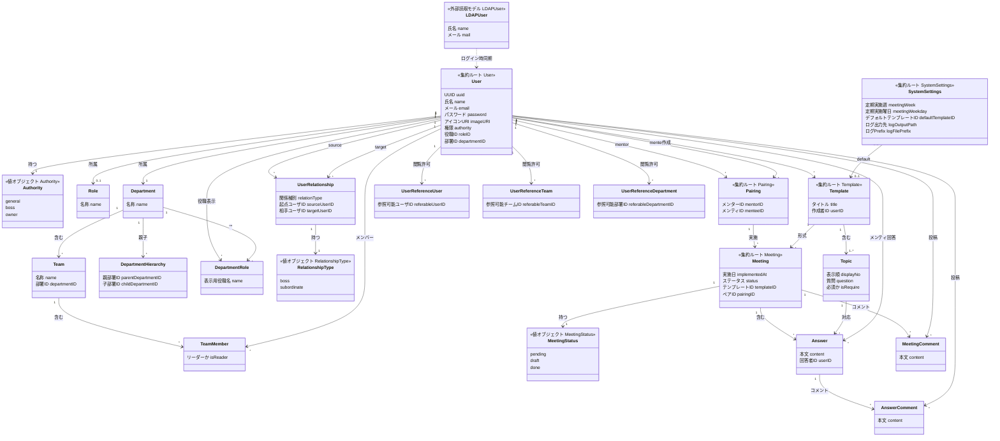

# ドメインモデル図

簡易クラス図。属性は代表のみ、メソッドは書かない。sudo モデリングの D。

和英対訳はクラス名・属性の英語が実装名（`internal/domain/entity`, `valueobject`）。

%% --- ルール / 制約（ドメイン知識） ---
%%
%% User
%% - authority=owner は Basic ログインに制限する運用。password は nullable（LDAP ユーザは NULL 可）
%% - 閲覧スコープ: general は自分のミーティング。メンターは pairings。上司は user_relationships の部下。owner は全件
%%
%% Pairing vs UserRelationship
%% - Pairing: mentor–mentee（1on1 参加ペア）。ミーティング作成・メンター閲覧の基準
%% - UserRelationship: boss|subordinate（組織）。上司の部下ミーティング閲覧・boss のペアリング操作範囲の基準
%% - 両者の役割を混ぜない
%%
%% Meeting 集約
%% - status: pending → draft → done。提出時は submitted を経由せず done にする
%% - done 以外は権限者以外から見えない
%% - Answer.user_id はメンティ（pairings.mentee_id）
%% - meeting_comments.content は not null
%%
%% Template 集約
%% - topics は 1 件以上必須
%%
%% SystemSettings
%% - 単一行想定。定期ミーティング自動作成（cron）とデフォルトテンプレート指定
%%
%% 永続化しない / 設計外
%% - histories, read_commentables は持たない
%% - セッションはインフラ層
%%
%% 集約と Repository（実装の目安）
%% - User: UserRepository
%% - Department / Team / DepartmentHierarchy / DepartmentRole: 各 Repository
%% - Pairing: PairingRepository
%% - UserRelationship: UserRelationshipRepository
%% - Template + Topic: TemplateRepository, TopicRepository
%% - Meeting + Answer + AnswerComment + MeetingComment: 各 Repository
%% - SystemSettings: SystemSettingsRepository
%% - UserReference*: 各 Repository
