# ER図

正本。テーブル定義は `internal/domain/entity` と一致させる。

```mermaid
erDiagram

%% 各テーブルは bigint id PKを所持
%% 各テーブルは created_at, updated_at, deleted_atを所持
%% 各テーブルは uuid uuid UK(Unique Key)を所持
%% tables { bigint id PK, datetime created_at, datetime updated_at, deleted_at } が存在する前提とする。
%% pending|draft|done / general|boss|owner / boss|subordinate / none|system_admin|analyst / none|department|team|subordinate は Domain Value Object（列挙体）。マスタテーブルは持たない。
%% VO列は smallint で保持する。
%% histories / read_commentables テーブルは持たない。
%% users.image_uri はプロフィール画像の保存先（nullable）。バイナリ列は持たない。ImageBase64 は永続化しない。
%% users.department_id は主所属。複数部署への所属は user_departments で表す。

%% ユーザ系
users {
    text name "not null"
    text email "not null"
    text password "nullable。Basic認証用。Owner は Basic ログインに制限する運用"
    text image_uri "nullable。イメージ画像の保存先"
    smallint authority "not null, general|boss|owner"
    smallint system_role "not null, default 1(none)。none|system_admin|analyst"
    smallint operation_target "not null, default 1(none)。none|department|team|subordinate"
    boolean suspended "not null, default false。停止中"
    text line_works_id "not null, default 空文字。LINE WORKS ID"
    boolean remind_enabled "not null, default false。リマインド対象"

    bigint role_id FK
    bigint department_id FK "主所属部署"
}
roles ||--o{ users: ""
departments ||--|{ users: "主所属"

%% ユーザが複数部署に所属する中間テーブル。users.department_id（主所属）とは別に持つ
user_departments {
    bigint user_id FK "UK(user_id, department_id)"
    bigint department_id FK "UK(user_id, department_id)"
}
users ||--o{ user_departments: "所属ユーザ"
departments ||--o{ user_departments: "所属部署"

team_members {
    boolean is_reader "not null, default false。チームリーダーフラグ"

    bigint team_id FK
    bigint member_id FK
}
teams ||--o{ team_members: "チームID"
users ||--o{ team_members: "メンバーID"

department_members {
    boolean is_head "not null, default false。部長。is_manager も true"
    boolean is_manager "not null, default false。部内と子孫部署の面談を参照"

    bigint department_id FK "UK(department_id, user_id)"
    bigint user_id FK "UK(department_id, user_id)"
}
departments ||--o{ department_members: "部署メンバー"
users ||--o{ department_members: "ユーザ"

departments {
    text name "not null"

    bigint head_user_id FK "not null, default 0。部署長"
}

roles {
    text name "not null"
    number rank "not null, default 0。表示・並び順"
}

teams {
    text name "not null"

    bigint department_id FK
}
departments ||--|{ teams: "部署＞チーム（SM以下のチームを想定）"

pairings {
    boolean is_temporary "not null, default false。一時ペア"
    number recur_week "nullable。定期実施：第N週"
    number recur_weekday "nullable。定期実施：曜日（0=日曜）"

    bigint mentor_id FK
    bigint mentee_id FK "代表メンティ"
    bigint created_by_user_id FK "not null, default 0。作成者"
}
%% pairings: 1on1 の mentor–mentee。ミーティング作成・メンター閲覧の基準
%% 複数メンティは pairing_mentees。共有先は pairing_sharers / pairing_targets
users ||--o{ pairings: "Mentor"
users ||--o{ pairings: "Mentee"

pairing_mentees {
    bigint pairing_id FK
    bigint user_id FK
}
pairings ||--o{ pairing_mentees: ""
users ||--o{ pairing_mentees: "メンティ"

pairing_sharers {
    bigint pairing_id FK
    bigint user_id FK
}
pairings ||--o{ pairing_sharers: ""
users ||--o{ pairing_sharers: "共有先ユーザ"

pairing_targets {
    text kind "not null, user|team|department"
    bigint target_id "not null。kind に応じた対象ID（多相。単一FKではない）"

    bigint pairing_id FK
}
pairings ||--o{ pairing_targets: "共有対象"

%% ミーティング系
%% status が done 以外では他ユーザから見られないようにする
meetings {
    datetime implemented_at "nullable。ミーティング実施日"
    smallint status "not null, pending|draft|done"

    bigint template_id FK
    bigint pairing_id FK
    bigint created_by_user_id FK "not null, default 0。作成者"
}
templates ||--o{ meetings: "ミーティングにはテンプレートの指定が必須"
pairings ||--o{ meetings: "参加ペア"

meeting_sharers {
    bigint meeting_id FK
    bigint user_id FK
}
meetings ||--o{ meeting_sharers: ""
users ||--o{ meeting_sharers: "共有先ユーザ"

templates {
    text title UK
    text description "not null, default 空文字"
    number display_no "not null, default 0。表示順序"
    boolean is_sample "not null, default false。サンプルテンプレート"

    bigint creator_id FK "作成者のユーザID（列名 creator_id）"
}
users ||--o{ templates: "テンプレートには作成者が存在"

topics {
    number display_no "表示順序 1~N"
    text question "not null"
    text description "not null, default 空文字"
    bool is_require "not null"

    bigint template_id FK
}
templates ||--|{ topics: "テンプレートに対して、１以上のトピックが存在する"

answers {
    text content "not null"

    bigint meeting_id FK
    bigint topic_id FK
    bigint user_id FK "回答者ユーザID（メンティ）"
}
meetings ||--o{ answers: ""
topics ||--o{ answers: ""
users ||--o{ answers: "メンティの回答"

meeting_comments {
    text content "not null"
    boolean is_limited "not null, default false。限定公開"

    bigint meeting_id FK
    bigint user_id FK
}
meetings ||--o{ meeting_comments: ""
users ||--o{ meeting_comments: ""

answer_comments {
    text content "nullable"

    bigint answer_id FK
    bigint user_id FK
}
answers ||--o{ answer_comments: ""
users ||--o{ answer_comments: ""

%% user_relationships: 上司–部下。pairings（mentor–mentee）とは役割を分離
user_relationships {
    smallint relation_type "not null, boss|subordinate"

    bigint source_user_id FK
    bigint target_user_id FK
}
%% Source側からTargetを見た場合のリレーションを記述
%% 例: relation_type=subordinate, source=部下ID, target=上司ID
users ||--o{ user_relationships: "source_user_id"
users ||--o{ user_relationships: "target_user_id"

system_settings {
    number meeting_week "定期実施：第N週"
    number meeting_weekday "定期実施：曜日（0=日曜）"
    bigint default_template_id FK "デフォルトテンプレート"
    text log_output_path "ログ出力先"
    text log_file_prefix "ログファイルPrefix"
    boolean remind_auto_send "not null, default false。リマインド自動送信"
    text remind_mode "not null, default prev_weekday。送信モード"
    number remind_days_before "not null, default 1。何日前"
    number remind_weekday "not null, default 1。曜日"
    text remind_time "not null, default 09:00。送信時刻"
}
templates ||--o| system_settings: "default_template_id"

department_hierarchies {
    bigint parent_department_id FK
    bigint child_department_id FK
}
departments ||--o{ department_hierarchies: "parent_department_id"
departments ||--o{ department_hierarchies: "child_department_id"

department_roles {
    text name "ロール名。表示上利用するのみのため自由入力"

    bigint user_id FK
    bigint department_id FK
}
users ||--o{ department_roles: "役職名"
departments ||--o{ department_roles: "部署ID"

user_reference_users {
    bigint user_id FK
    bigint referable_user_id FK
}
users ||--o{ user_reference_users: ""
users ||--o{ user_reference_users: "参照可能ユーザID"

user_reference_teams {
    bigint user_id FK
    bigint referable_team_id FK
}
users ||--o{ user_reference_teams: ""
users ||--o{ user_reference_teams: "参照可能チームID"

user_reference_departments {
    bigint user_id FK
    bigint referable_department_id FK
}
users ||--o{ user_reference_departments: ""
users ||--o{ user_reference_departments: "参照可能部署ID"
```

%% authority 閲覧範囲（列コメント補足）
%% - general: 自分がメンティのミーティング
%% - メンター閲覧: pairings.mentor_id
%% - department_members.is_head または is_manager: その部署と子孫部署のメンバー、および所属チームのメンティー面談
%% - team_members.is_reader: そのチームのメンティー面談
%% - boss: user_relationships で部下のミーティング
%% - owner: 全件
%% 役職名（department_roles.name や SM 表示）は参照判定に使わない
%% system_role: none / system_admin（システム管理者）/ analyst（分析者）
%% operation_target: none / department（部署）/ team（チーム）/ subordinate（部下）
