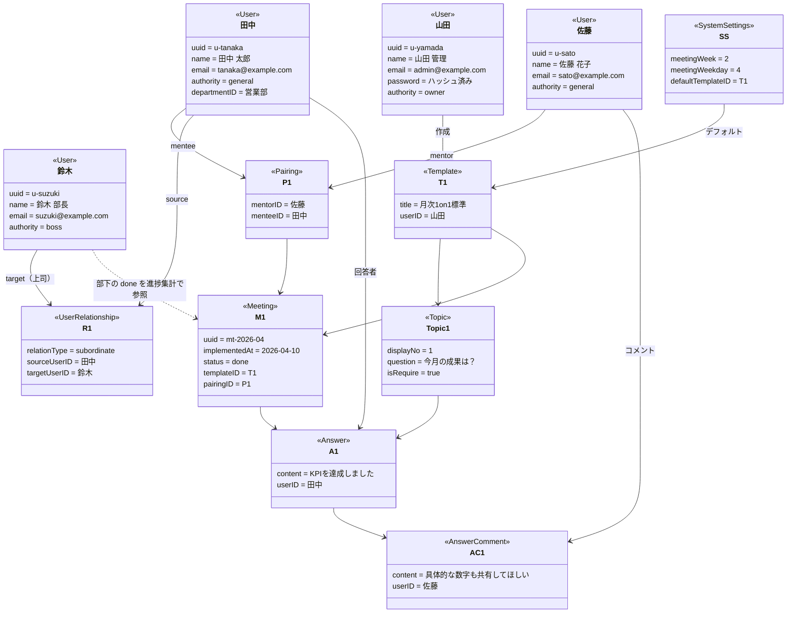

# オブジェクト図

ドメインモデルの具体例。sudo モデリングの O。

シナリオ: 4月の 1on1 でメンティ田中が下書き保存後に提出する。メンター佐藤がトピックにコメントし、上司鈴木が進捗画面で部署単位の完了率を確認する。

%% この時点の状態
%% 1. system_settings により第2週木曜が次回実施日としてホームに表示される（cron で meetings 生成は別タイミング）
%% 2. 田中が draft 保存後 POST /api/v1/meeting/:uuid で status=done に提出
%% 3. 佐藤は pairings 経由で閲覧し、answer_comments を POST
%% 4. 鈴木は user_relationships 経由で田中の done ミーティングを閲覧可。/management/progress で部署集計
%% 5. 山田は owner。全ミーティング・全管理タブ・Basic ログイン
