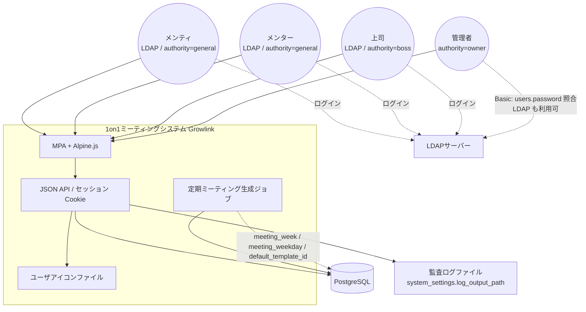

# システム関連図（System Context）

開発するシステムと、関わりのあるアクター・外部システムとの関連。sudo モデリングの S。

%% 境界メモ
%% - mentee / mentor / boss は LDAP 認証。owner は Basic 認証（password を持つユーザ）。Owner ロールは Basic に制限する運用
%% - セッションはインフラ層（histories テーブルは持たない）
%% - pairings = mentor–mentee（1on1）。user_relationships = 上司–部下（組織）。閲覧範囲は別途 user_reference_* で拡張可
%% - meetings.status が done 以外のミーティングは、権限者以外から見えない
%% - 画面遷移の詳細は doc/model/old/statedisplaytransition.md を参考（SUDO 正本ではない）
